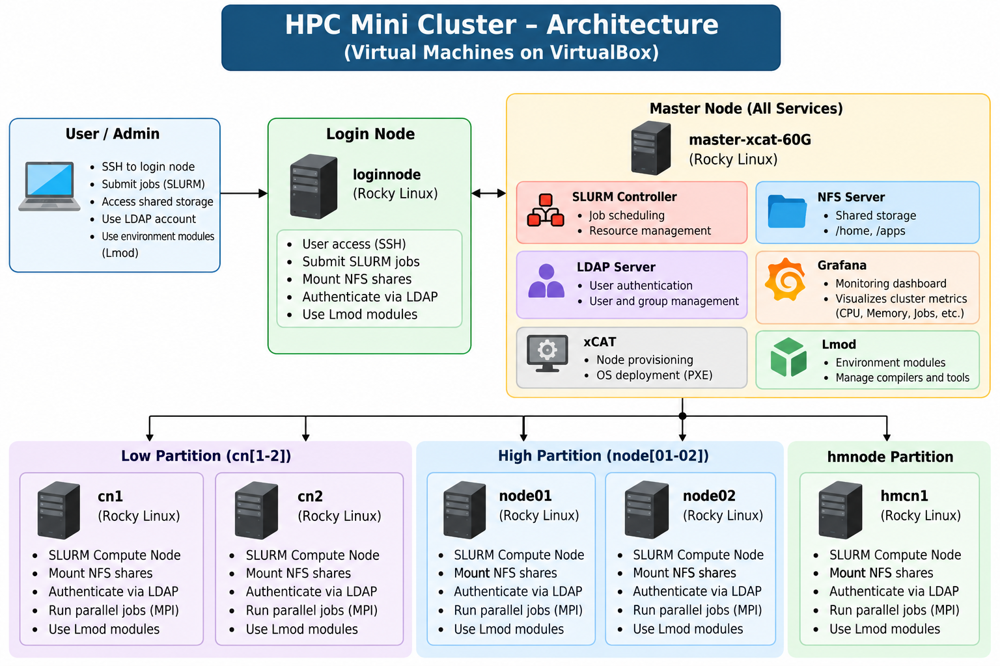

# HPC Mini-Cluster Infrastructure

## Overview

This project documents the setup and configuration of a High Performance Computing (HPC) mini-cluster using Rocky Linux. It covers cluster management, job scheduling, shared storage, centralized user authentication, and monitoring.

## Technologies Used

- **Operating System:** Rocky Linux
- **Cluster Management and Provisioning:** xCAT
- **Job Scheduling:** SLURM
- **Shared Storage:** NFS
- **User Authentication:** LDAP
- **Monitoring:** Grafana

## Project Components

- **xCAT:** Manages compute-node definitions and operating system provisioning.
- **SLURM:** Manages compute nodes, partitions, and job scheduling.
- **NFS:** Provides shared directories across configured systems.
- **LDAP:** Supports centralized user and group lookup.
- **Grafana:** Used for cluster monitoring.

## Architecture Diagram

- The following diagram illustrates the high-level architecture of the HPC mini-cluster and its main components.



## Repository Structure

```text
hpc-mini-cluster-infrastructure/
├── README.md
├── configs/
│   ├── slurm/
│   ├── nfs/
│   ├── ldap/
│   └── xcat/
└── docs/
    └── configuration-reference.md
    └── architecture.png
    └── installation_guide.md


```

## Documentation

This repository contains configuration examples and documentation describing the cluster setup. The examples are intended for learning and reference; review hostnames, IP addresses, permissions, and other settings before applying them to another environment.

## Learning Objectives

- Understand HPC cluster architecture and administration.
- Configure and document SLURM job scheduling.
- Explore xCAT-based node provisioning.
- Understand shared storage with NFS.
- Learn centralized identity lookup using LDAP.
- Explore cluster monitoring with Grafana.

## Notes

Configuration examples may require changes for your environment.
